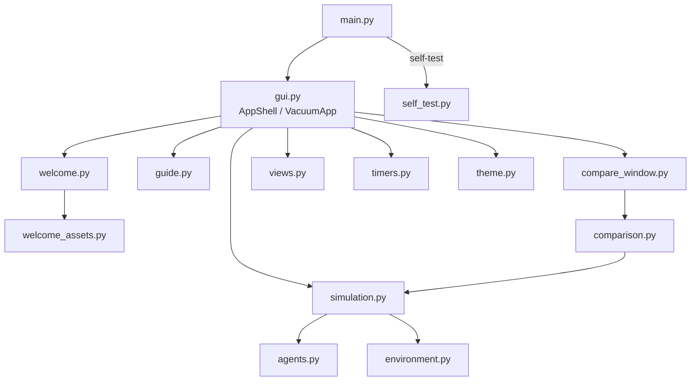

# Robot Süpürge Ajanı

Python ile geliştirilen, farklı yapay zekâ ajanlarının iki odalı ve çok odalı
ortamlardaki davranışlarını simüle eden masaüstü uygulaması.


## İçindekiler

- [Proje hakkında](#proje-hakkında)
- [Temel özellikler](#temel-özellikler)
- [Ajan türleri](#ajan-türleri)
- [Ortam ve simülasyon kuralları](#ortam-ve-simülasyon-kuralları)
- [Arayüz ve kullanım](#arayüz-ve-kullanım)
- [Ekran görüntüleri](#ekran-görüntüleri)
- [Kurulum](#kurulum)
- [EXE ile çalıştırma](#exe-ile-çalıştırma)
- [Proje mimarisi](#proje-mimarisi)
- [Ajan karşılaştırması](#ajan-karşılaştırması)
- [Testler ve doğrulama](#testler-ve-doğrulama)
- [LMS teslimi](#lms-teslimi)
- [Teknik sınırlamalar](#teknik-sınırlamalar)
- [Lisans ve katkı](#lisans-ve-katkı)

## Proje hakkında

Bu proje, Yapay Zekâya Giriş dersinin Dönem İçi Proje 1 ödevi olarak
geliştirilmiştir. Amaç, ders kitaplarındaki klasik "elektrikli süpürge
dünyası" örneği üzerinden **akıllı ajan** (intelligent agent) kavramını
çalışan bir programla incelemektir.

Bir ajan, ortamını algılayıcılarıyla algılayan ve eylemleriyle ortamı
etkileyen bir varlıktır. Bu projede ajan bir robot süpürgedir:

- **Algı (percept):** Bulunduğu oda ve o odanın temiz ya da kirli olması.
  Ajan diğer odaları göremez.
- **Eylem (action):** Temizle, Sola git, Sağa git, Yukarı git, Aşağı git.
- **Ortam (environment):** Kendiliğinden yeniden kirlenen bir veya daha fazla
  oda.

Simülasyon her adımda **algı–karar–eylem döngüsünü** işletir: ajan bulunduğu
odayı algılar, kararını verir ve tek bir eylem gerçekleştirir; ortam eylemi
uygular. Aynı ortamda üç farklı ajan mimarisi çalıştırılabildiği için, karar
mekanizmasındaki farkların (bellek kullanımı, iç model, hedef ve plan) davranışa
nasıl yansıdığı doğrudan gözlenebilir ve ölçülebilir.

> **Not:** Bu proje bir makine öğrenmesi sistemi değildir. Ajanların hiçbiri
> deneyimden öğrenmez; karar kuralları sabittir ve kaynak kodda açıkça
> tanımlıdır. Model tabanlı ajanın "iç modeli" bir öğrenme modeli değil,
> ajanın gördüklerini kaydettiği bir bellektir.

Ödevin zorunlu kısmı (iki oda, basit refleks ajan, otomatik kirlenme, günlük,
durdurma) ve isteğe bağlı geliştirmeler (çok odalı grid, model tabanlı ajan,
amaç tabanlı ajan) uygulanmıştır.

## Temel özellikler

**Ortam ve ajanlar**

- İki odalı A–B ortamı (ödevin zorunlu senaryosu, varsayılan ayar)
- 6×6'ya kadar çok odalı iki boyutlu grid ortamı
- Basit refleks ajan, model tabanlı ajan ve amaç tabanlı ajan
- Amaç tabanlı ajanda BFS (genişlik öncelikli arama) ile en kısa rota planlama
- Zamanlayıcıyla otomatik kirlenme (her tetiklemede temiz odalar %30 olasılıkla)
- Seed ile tekrarlanabilir deneyler

**Görselleştirme ve izleme**

- Gerçek ortam ile ajanın iç modelinin yan yana gösterimi
- İç modelde bilinen, bilinmeyen, eski ve çıkarımla elde edilen bilgilerin ayrımı
- Amaç tabanlı ajanın hedefinin ve kalan rotasının gösterimi
- Sütunlu algı ve eylem günlüğü (adım, süre, oda, algı, eylem, açıklama)
- Simülasyon istatistikleri: durum, kirli/bilinen oda, adım, temizleme, hareket, süre

**Kullanım**

- Başlat, Duraklat / Devam ve Durdur; Boşluk ve Esc kısayolları
- Üç ajanı aynı koşullarda ölçen karşılaştırma ekranı
- ttkbootstrap temalı arayüz (ttkbootstrap yoksa standart ttk ile çalışır)
- Karşılama ekranı ve 16 adımlık etkileşimli "Nasıl Oynanır?" rehberi
- PyInstaller ile Windows EXE paketleme

## Ajan türleri

Üç ajan da aynı arayüzü kullanır: her adımda yalnızca güncel algıyı
(`(oda, durum)`) alır ve bir eylem döndürür. Ortamın tamamına erişimleri yoktur.

### Basit Refleks Ajan (Simple Reflex Agent)

Kararını yalnızca güncel algıya göre verir. Geçmiş algıları, önceki eylemleri,
ziyaret edilen odaları ve günlük kayıtlarını saklamaz ve kullanmaz.

- Oda kirliyse **Temizle**.
- Oda temizse başka bir odaya **hareket et**.

İki odalı ortamda ödevin karar tablosu birebir uygulanır:

| Güncel algı | Eylem |
|---|---|
| A odası, kirli | Temizle |
| A odası, temiz | Sağa git (B odasına) |
| B odası, kirli | Temizle |
| B odası, temiz | Sola git (A odasına) |

Çok odalı grid'lerde oda temizse, bulunulan odadan ortam sınırları içinde
kalan hareketlerden biri **rastgele** seçilir. Ajan yalnızca değişmez grid
yerleşimini ve bir rastgele sayı üretecini tutar; üreteç bir algı belleği
değildir ve olası seçimleri değiştirmez.

### Model Tabanlı Ajan (Model-Based Agent)

Algılarından bir **iç model** kurar. Model, her oda için son bilinen durumu,
bu bilginin ait olduğu ajan adımını ve bilginin kaynağını tutar:

- **Algı:** Ajan odayı kendisi gördü.
- **Çıkarım:** Ajan başarılı bir Temizle eyleminden sonra odayı görmeden
  "temiz" kabul etti. Simülasyon her eylemden sonra ajana eylemin başarılı olup
  olmadığını bildirir; başarısız eylemden çıkarım yapılmaz. Başarılı bir
  hareketten sonra yalnızca ajanın kendi konumu güncellenir.
- **Bilinmiyor:** Hiç algılanmamış odalar modelde yoktur.

Bilginin **yaşı**, son bilgiden bu yana geçen ajan adımıdır; gerçek süre ya da
bir kirlenme olasılığı değildir. Arayüz, yaşı max(4, oda sayısı) veya daha
büyük olan bilgiyi "Eski" olarak gösterir; bu eşik yalnızca görselleştirme
içindir, ajanın kararını etkilemez.

**Karar kuralı:** Oda kirliyse Temizle. Temizse komşu odalar arasından önce
**hiç algılanmamış** olana, bütün komşular biliniyorsa **son bilgisi en eski**
olana gider. Eşitlikte seed'li rastgele seçim yapılır.

**İç model neden gerçek durumdan farklılaşır?** Ajan yalnızca bulunduğu odayı
görür; diğer odalar o sırada kirlenebilir. Örneğin ajan A1'i temizleyip
uzaklaştıktan sonra A1 yeniden kirlenirse, ajan oraya dönüp algılayana kadar
modelinde A1 "temiz" olarak kalır. Arayüzdeki "Ajanın iç modeli (gerçek
durum değil)" paneli bu farkı gösterir.

İki odalı ortamda her odadan yalnızca bir geçerli hareket olduğundan bu ajanın
hareketleri refleks ajanla aynı olabilir; fark iç modelde ve en az üç odalı
grid'lerde görülür.

### Amaç Tabanlı Ajan (Goal-Based Agent)

Model tabanlı ajanın iç modelini aynen kullanır. Amacı, temiz olduğundan en az
emin olunan odayı kontrol etmek ve kirliyse temizlemektir. Bunun için açık bir
**hedef oda** seçer, oraya **BFS** ile en kısa rotayı çıkarır ve rotayı adım
adım izler. Bulunduğu oda kirliyse önce temizler.

**Hedef öncelikleri** (yalnızca iç model, grid ve ajanın kendi konumu kullanılır):

1. **Bilinen kirli oda:** en kısa BFS mesafesindeki.
2. **Hiç algılanmamış oda:** en kısa BFS mesafesindeki.
3. **Keşif:** daha önce görülmüş odalar arasında `(yaş + d) / d` puanı en
   yüksek olan (`d`: BFS mesafesi). Bu sezgisel bir kuraldır; kesin bir
   kirlenme olasılığı ya da kanıtlanmış en iyi strateji değildir.

Eşitlikte önce kısa mesafe, sonra seed'li rastgele seçim kullanılır; ajanın
bulunduğu oda hedef seçilmez. Ajan kirli gördüğü odayı hemen temizlediği ve
uzaktaki kirlenmeyi göremediği için 1. öncelik pratikte nadiren oluşur.

**BFS:** Komşular her zaman Sol, Sağ, Yukarı, Aşağı sırasıyla gezilir; aynı
uzunlukta birden fazla en kısa rota varsa bu sıra belirleyicidir.

**Hedefe bağlılık:** Hedef her adımda yeniden seçilmez. Hedefe ulaşıldığında,
hedef geçersizleştiğinde, daha öncelikli bir hedef türü ortaya çıktığında,
hareket başarısız olduğunda ya da rota ajanın bildiği konumdan hedefe
ulaşmadığında yeniden planlanır. Hedef değişiklikleri günlükte ayrı bir satır
olarak gösterilir.

**Gösterim:** İç model panelinde hedef mor çerçeveyle, kalan rota mor okla
çizilir; gerçek ortam panelinde yalnızca hedef ◆ ile işaretlenir.

### Karşılaştırma

| | Basit Refleks | Model Tabanlı | Amaç Tabanlı |
|---|---|---|---|
| Kullandığı bilgi | Yalnızca güncel algı | Güncel algı + iç model | Güncel algı + iç model + hedef/plan |
| Bellek | Yok | Her odanın son durumu, adımı ve kaynağı | Model tabanlı ajanla aynı |
| Temiz odada hareket | 1×2'de tablo; grid'de rastgele geçerli yön | Bilinmeyen, sonra en eski bilgili komşu | Hedefe giden BFS rotasının ilk adımı |
| Bakış ufku | Tek adım | Tek adım (yalnızca komşular) | Bütün grid (hedef ve rota) |
| Öğrenme | Yok | Yok | Yok |

## Ortam ve simülasyon kuralları

| Kural | Açıklama |
|---|---|
| Oda durumları | Her oda **Temiz** ya da **Kirli**dir. |
| Oda adları | 1×2 ortamda **A** (solda) ve **B** (sağda). Diğer grid'lerde satır harfi ve sütun numarası: `A1 … F6` (A en üst satır, 1 en sol sütun). |
| Grid boyutu | Satır ve sütun 1–6 arası; en az 2 oda. Varsayılan 1×2. |
| Başlangıç | Ajanın başlangıç odası ve her odanın temiz/kirli durumu rastgele (seed'e bağlı) belirlenir. |
| Hareketler | Sola, Sağa, Yukarı, Aşağı; yalnızca grid sınırları içinde. Ajanlar yalnızca bulundukları odadan geçerli olan hareketleri seçer; sınır dışı bir hareket ortam tarafından hata olarak reddedilir ve konum değişmez. |
| Temizleme | Bulunulan odayı temiz yapar. |
| Adım | Her adımda tek eylem: temizleme ve hareket ayrı adımlardır. |
| Otomatik kirlenme | Kirlenme zamanlayıcısı her tetiklendiğinde **temiz** odaların her biri birbirinden bağımsız olarak **%30** olasılıkla kirlenir. Kirlenme adım sayılmaz. |
| Zamanlayıcılar | Adım ve kirlenme zamanlayıcıları birbirinden bağımsızdır. Duraklatınca ikisi de kalan süresini korur; devam edince o süreden sürer. |
| Süre | Bütün odalar temiz olsa bile ajan kullanıcı durdurana kadar dolaşmaya devam eder. |
| Seed | Aynı seed ve aynı ayarlar başlangıç durumunu, kirlenmeleri ve ajanın rastgele seçimlerini aynen tekrarlar. Boş bırakılırsa her çalıştırma farklıdır. |

Ortam, ajanlar, simülasyon ve karşılaştırma çekirdeği Tkinter kullanmaz;
arayüzden bağımsız olarak çalıştırılıp test edilebilir.

## Arayüz ve kullanım

Bütün ekranlar aynı ana pencerede açılır.

### 1. Karşılama ekranı

Program açıldığında solda robot süpürge illüstrasyonu, sağda başlık, kısa
açıklama ve iki düğme, altta dört özellik tanıtımı görünür. Dar pencerede
illüstrasyon küçülerek üste geçer; düğmeler her boyutta görünür kalır.

### 2. Oyna

**Oyna** (ya da Enter) simülasyon ekranını açar. Simülasyon ekranı yukarıdan
aşağıya şu bölümlerden oluşur: Ayarlar ve kontrol düğmeleri, Gerçek Ortam ve
Ajanın İç Modeli, Simülasyon Durumu, Algı ve Eylem Günlüğü.

### 3. Nasıl Oynanır?

16 adımlık etkileşimli rehber, gerçek simülasyon ekranının üzerinde çalışır ve
arayüzü sırayla tanıtır: adım aralığı, kirlenme aralığı, seed, satır, sütun,
ajan türü, Başlat, Duraklat/Devam, Durdur, Ajanları Karşılaştır, gerçek ortam,
ajanın iç modeli, hedef ve rota, simülasyon durumu, algı ve eylem günlüğü ve
Ana Menü.

- Her adımda ilgili bileşen aydınlık bırakılır ve mavi çerçeveyle vurgulanır;
  pencerenin geri kalanı yarı saydam lacivertle karartılır. Açıklama kutusu
  hedefi kapatmayacak biçimde yerleşir, dar pencerede daralır.
- Örnek ortam 3×3 ve amaç tabanlı ajandır (seed 299). Gerçek simülasyon
  zamanlayıcı kullanılmadan 14 adım ilerletilip duraklatılır; iç modeldeki
  bilinen, bilinmeyen ve eski odalar, hedef ve rota gerçek simülasyon
  verisidir. Rehber açıkken simülasyon ilerlemez, ayarlar ve düğmeler
  kullanılamaz.
- Son adımda **Ana Menü'ye Dön** ve **Oyna** seçenekleri vardır; Oyna temiz
  bir simülasyon açar.

### 4. Ayarlar

| Ayar | Değer aralığı | Varsayılan | Açıklama |
|---|---|---|---|
| Adım aralığı (ms) | 100–5000 | 700 | Ajanın iki adımı arasındaki süre. Çalışırken değiştirilebilir. |
| Kirlenme aralığı (sn) | 0,5–60 | 3 | Kirlenme tetiklemeleri arasındaki süre. Çalışırken değiştirilebilir. |
| Seed | Tam sayı ya da boş | Boş | Aynı seed aynı başlangıcı, kirlenmeleri ve ajan seçimlerini üretir. |
| Satır | 1–6 | 1 | Grid satır sayısı. Başlat'ta uygulanır. |
| Sütun | 1–6 | 2 | Grid sütun sayısı (en az 2 oda). Başlat'ta uygulanır. |
| Ajan türü | Basit Refleks Ajan, Model Tabanlı Ajan, Amaç Tabanlı Ajan | Basit Refleks Ajan | Başlat'ta uygulanır. |

Satır, sütun ve ajan türü simülasyon çalışırken ya da duraklatılmışken
değiştirilemez. Aralık dışındaki değerler sınıra çekilir; sayı olmayan bir
değer girilirse son geçerli değer kullanılır.

### 5. Kontrol düğmeleri

| Düğme | İşlev |
|---|---|
| **Başlat** | Yeni bir simülasyon başlatır; önceki durum ve günlük sıfırlanır. |
| **Duraklat / Devam** | Durumu koruyarak askıya alır ya da kaldığı yerden sürdürür; süre göstergesi de durur. |
| **Durdur** | Simülasyonu sonlandırır; son durum ve günlük ekranda kalır, süre sabitlenir. |
| **Ajanları Karşılaştır** | Karşılaştırma penceresini açar; ana simülasyonu etkilemez. |
| **Ekranı Temizle** | Günlük tablosundaki satırları ekrandan siler; simülasyonun kendi kayıtlarına dokunmaz. |
| **Ana Menü** | Simülasyonu durdurur, zamanlayıcıları iptal eder, açık karşılaştırma penceresini kapatır ve karşılama ekranına döner. |

**Klavye kısayolları**

| Ekran | Tuş | İşlev |
|---|---|---|
| Karşılama | Enter | Oyna |
| Simülasyon | Boşluk | Duraklat / Devam (yazı alanındayken etkisiz) |
| Simülasyon | Esc | Durdur |
| Rehber | Sağ ok, Enter | İleri |
| Rehber | Sol ok | Geri |
| Rehber | Esc | Ana Menü |

### 6. Gerçek Ortam

| Görünüm | Anlamı |
|---|---|
| Yeşil (küçük hücrede **T**) | Temiz oda |
| Lekeli kahverengi (küçük hücrede **K**) | Kirli oda |
| Mavi çerçeve ve robot | Ajanın bulunduğu oda |
| ◆ Mor elmas | Amaç tabanlı ajanın hedefi |

### 7. Ajanın İç Modeli

Model tabanlı ve amaç tabanlı ajanda görünür. Yalnızca ajanın salt okunur
model ve plan kopyalarından çizilir; ajana bilgi vermez ve belleğini
değiştiremez.

| Görünüm | Anlamı |
|---|---|
| Gri, `?` | Bilinmiyor (hiç algılanmadı) |
| Yeşil | Temiz (algı) |
| Yeşil, kesikli kenar | Temiz (çıkarım) |
| Sarı, çizgili, "Eski" | Eskimiş bilgi: yaş ≥ max(4, oda sayısı) |
| Kahverengi | Kirli |
| ● Mavi nokta | Ajanın bildiği kendi konumu |
| Mor çerçeve ve ok | Amaç tabanlı ajanın hedefi ve kalan rotası |

### 8. Simülasyon Durumu

Durum (çalışıyor, duraklatıldı, durduruldu), seçili ajan türü, ortam boyutu,
kirli oda sayısı, bilinen oda sayısı (model ve amaç tabanlı ajan), hedef ve
kalan rota (amaç tabanlı ajan), adım, temizleme ve hareket sayıları ile geçen
süre gösterilir.

### 9. Algı ve Eylem Günlüğü

| Adım | Süre | Oda | Algı | Eylem | Açıklama |
|---|---|---|---|---|---|
| 12 | 00:08.4 | A | Kirli | Temizle | – |
| – | 00:09.0 | B | – | – | Kirlenme: B odası kirlendi |
| – | 00:09.1 | A1 | – | – | Hedef: A1 (keşif, 2 adım, puan 6.00) — hedefe ulaşıldı |

- Adım satırları algı–eylem kayıtlarıdır. Kirlenme (turuncu), hedef değişimi
  (mor) ve bilgi (mavi) satırları adım sayısını artırmaz.
- Ekranda en fazla 10.000 satır tutulur; eski satırlar kaldırıldığında en üstte
  bilgi verilir. Simülasyonun kendi günlüğü eksiksiz korunur.
- Kullanıcı eski kayıtlara bakarken otomatik kaydırma görünümü bozmaz.
- Günlük yalnızca izleme içindir; ajanların kararlarında kullanılmaz.

### 10. Ajanları Karşılaştır

Ayrı bir pencerede üç ajanı aynı koşullarda ölçer; ayrıntılar
[Ajan karşılaştırması](#ajan-karşılaştırması) bölümündedir.

### 11. Ana Menü'ye dönüş

Simülasyon ekranının sağ üstündeki **Ana Menü** düğmesi simülasyonu güvenle
kapatır ve karşılama ekranını gösterir. Yeniden Oyna yeni bir oturum açar.

## Ekran görüntüleri

Depoda henüz uygulama ekran görüntüsü bulunmamaktadır. Bu bölüm için önerilen
görüntüler:

- Karşılama ekranı
- Simülasyon ana ekranı (ör. 3×3, amaç tabanlı ajan)
- Etkileşimli "Nasıl Oynanır?" rehberinden bir adım
- Ajan karşılaştırma ekranı

`assets/welcome/` klasöründeki görseller uygulamanın karşılama ekranında
kullanılan tasarım kaynaklarıdır; uygulama ekran görüntüsü değildir.

## Kurulum

**Gereksinimler**

- Python 3.9 veya üzeri. Proje Python 3.9, 3.12 ve 3.13 ile test edilmiştir.
- Tkinter (Python'un Windows kurulumuyla birlikte gelir).
- `requirements.txt` içindeki **ttkbootstrap 1.14.7** (bağımlılığı Pillow).

ttkbootstrap kurulu değilse program aynı renklerle standart ttk ("clam")
temasında çalışır; bütün işlevler aynıdır, yalnızca görünüm sadeleşir.

**Windows (Komut İstemi)**

```bat
git clone https://github.com/Mustafa-Aydin69/RobotSupurge.git
cd RobotSupurge
python -m venv .venv
.venv\Scripts\activate
python -m pip install -r requirements.txt
python main.py
```

**Windows (PowerShell)**

```powershell
git clone https://github.com/Mustafa-Aydin69/RobotSupurge.git
cd RobotSupurge
python -m venv .venv
.\.venv\Scripts\Activate.ps1
python -m pip install -r requirements.txt
python main.py
```

PowerShell betik çalıştırmayı engelliyorsa sanal ortamı etkinleştirmeden
`.venv\Scripts\python.exe main.py` biçiminde de çalıştırabilirsiniz.

**Pencere açmadan doğrulama** (çıkış kodu 0 = başarılı):

```bat
python main.py --self-test
```

## EXE ile çalıştırma

EXE dosyası depoda bulunmaz (`dist/` ve `build/` Git dışındadır); kaynak
koddan üretilir. Amaç, programın Python kurulu olmayan bir Windows
bilgisayarında da çift tıklanarak açılabilmesidir.

```bat
build_exe.bat
```

- Betik, PyInstaller 6.22.3'ü ve `requirements.txt`'teki ttkbootstrap'ı
  projeye özel `.venv-build` sanal ortamına kurar (global Python'a dokunmaz),
  kaynak kodu `--self-test` ile doğrular ve `dist\RobotSupurge.exe` dosyasını
  üretir (`--onefile --windowed`).
- `build_exe.bat onedir` tek klasörlük sürüm üretir
  (`dist\RobotSupurge\RobotSupurge.exe`); daha hızlı açılır ama çok sayıda
  dosyadan oluşur.
- Tek dosyalık sürüm ilk açılışta kendini geçici bir klasöre açtığı için
  birkaç saniye bekleyebilir.

**EXE doğrulaması** (sonuç dosyaya yazılır, çıkış kodu 0 = başarılı):

```bat
start /wait dist\RobotSupurge.exe --self-test --report self_test_report.txt
```

Pencereli EXE'de hata çıktısı görünmez. Gerekirse `ROBOT_DIAG_LOG` ortam
değişkeniyle bir tanılama günlüğü açılabilir; bu günlük arayüz hatalarını ve
ekran geçişlerini dosyaya yazar:

```bat
set ROBOT_DIAG_LOG=%TEMP%\robot_tani.txt
dist\RobotSupurge.exe
```

EXE imzasız olduğu için Windows SmartScreen ya da antivirüs bir uyarı
gösterebilir. EXE, Python kurulu olmayan temiz bir Windows bilgisayarında
henüz doğrulanmamıştır (bkz. [Teknik sınırlamalar](#teknik-sınırlamalar)).

## Proje mimarisi

| Dosya | Sorumluluk |
|---|---|
| `main.py` | Giriş noktası; `--self-test` ve `--report` seçenekleri |
| `environment.py` | Grid, oda adları, algılama, temizleme, hareket ve sınır kontrolü, kirlenme |
| `agents.py` | Basit refleks, model tabanlı ve amaç tabanlı ajanlar; BFS |
| `simulation.py` | Algı–karar–eylem döngüsü, durum yönetimi (hazır, çalışıyor, duraklatıldı, durduruldu) ve günlük |
| `comparison.py` | Ajan karşılaştırma ölçümleri ve parçalı (arayüzü dondurmayan) hesaplama |
| `gui.py` | Ekran geçişleri (`AppShell`), simülasyon ekranı (`VacuumApp`), durum kartları ve günlük |
| `views.py` | Tuval çizimleri: gerçek ortam, iç model, hedef ve rota |
| `timers.py` | Duraklatıldığında kalan süresini koruyan zamanlayıcı |
| `theme.py` | Renkler, yazı tipleri, boşluklar ve ttkbootstrap stilleri |
| `compare_window.py` | Ajan karşılaştırma penceresi (tablo ve çubuk grafik) |
| `welcome.py` | Karşılama ekranı; rehber adımlarının içeriği ve gezinmesi |
| `welcome_assets.py` | Karşılama ekranı görselleri (base64 PNG, kaynak koda gömülü) |
| `guide.py` | Etkileşimli rehber: karartma, vurgu, açıklama kutusu ve yerleşimi |
| `self_test.py` | Pencere açmadan çalışan 9 doğrulama kontrolü |

Repoda ayrıca `tests/` (testler ve referans veriler), `tools/` (komut satırı
karşılaştırma aracı ve karşılama görsellerini üreten betik), `assets/welcome/`
(görsel kaynakları), `build_exe.bat` ve `requirements.txt` bulunur.



Bağımlılık yönü arayüzden çekirdeğe doğrudur: arayüz `Simulation` nesnesini
iki bağımsız zamanlayıcıyla (adım ve kirlenme) sürer; simülasyon ajanı ve
ortamı yönetir. Ajan ortama doğrudan erişemez, yalnızca algıyı alır ve eylem
döndürür. Arayüz ajanın iç modelini ve planını yalnızca salt okunur
kopyalardan çizer.

## Ajan karşılaştırması

**Ajanları Karşılaştır** penceresi Basit Refleks, Model Tabanlı ve Amaç
Tabanlı ajanları aynı koşullarda ölçer. Ayarlar: grid satır/sütun (ana
penceredeki boyut), ilk seed (varsayılan 0), seed sayısı (20), adım sayısı
(3000), kirlenme sıklığı (her 4 adımda bir, %30) ve kirlenme biçimi (ortak ya
da bağımsız). Hesaplama küçük zaman dilimlerinde yürütüldüğü için arayüz
donmaz; **İptal** edilen ölçümün kısmi sonuçları gösterilmez.

**Aynı başlangıç:** Aynı seed üç ajana aynı başlangıç odasını ve aynı oda
durumlarını verir; bu her seed için doğrulanır.

**Ölçütler** (`comparison.py`):

| Ölçüt | Tanım |
|---|---|
| Kapsama adımı | Kirlenme kapalıyken bütün odaların en az bir kez algılandığı adım (başlangıç odası 1. adımda algılanır). Ortalama, ortanca ve en kötü değer gösterilir. |
| Tamamlanan kapsama | Adım sınırı içinde bütün odaları gören koşu sayısı. Tamamlanmayan koşuların değeri bilinmez (sağdan sansürlü veri); bu durumda ortalama yerine "≥" ile bir alt sınır gösterilir. |
| Ortalama temiz oda oranı | Kirlenme açıkken her adımdan sonra ölçülen (temiz oda sayısı / oda sayısı) değerlerinin ortalaması; ± seed'ler arası standart sapma. |
| Hareket / temizleme | Hareket sayısı / temizleme sayısı (bir temizlik için yapılan hareket). Hiç temizlik yapılmayan koşuda tanımsızdır ve ayrıca sayılır. |

**Kirlenme biçimleri:**

- **Ortak:** Her tetiklemede her oda için ajandan bağımsız bir rastgele sayı
  çekilir; üç ajan aynı kirlenme denemeleri dizisiyle karşılaşır. Kirli bir
  odaya deneme etkisiz kaldığı için gerçekleşen kirlenmeler yine ajanların
  temizliklerine göre farklılaşabilir.
- **Bağımsız:** Simülasyonun kendi mekanizması; ajanlar farklı hareket ettiği
  için karşılaştıkları kirlenmeler aynı olmaz.

**Örnek ölçüm** (6×6, seed 0–19, 3000 adım, her 4 adımda %30, ortak kirlenme;
mevcut kodla yeniden üretilmiştir):

| Ajan | Tamamlanan kapsama | Kapsama ort. / ortanca / en kötü | Temiz oda oranı | Hareket / temizleme |
|---|---|---|---|---|
| Basit Refleks | 20/20 | 350,6 / 267,5 / 1416 | 0,126 ± 0,003 | 1,47 |
| Model Tabanlı | 20/20 | 73,6 / 70,0 / 102 | 0,157 ± 0,004 | 1,00 |
| Amaç Tabanlı | 20/20 | 60,5 / 61,0 / 67 | 0,158 ± 0,005 | 1,01 |

**Yorum:** Kapsama adımı ortamın ne kadar hızlı tanındığını, temiz oda oranı
sürekli kirlenme altında ortamın ne kadar temiz tutulduğunu ölçer. Bu örnekte
bellek kullanan ajanlar odaları refleks ajandan çok daha hızlı keşfetmiştir;
temiz oda oranında ise model ve amaç tabanlı ajanlar arasındaki fark standart
sapma düzeyindedir. Sonuçlar grid boyutuna, kirlenme sıklığına ve seed'lere
göre değişir; hiçbir ajan her koşulda en iyi değildir.

Farklı grid'ler ve seed sayılarıyla ölçüm yapan bir komut satırı aracı da
vardır:

```bat
python -m tools.compare_agents
```

## Testler ve doğrulama

**Bütün testler:**

```bat
python -m unittest discover -s tests -v
```

- Ortam, grid, üç ajan, BFS, simülasyon, zamanlayıcılar, karşılaştırma, tema,
  arayüz, karşılama ekranı, rehber, gömülü görseller, LMS teslim listesi ve
  `--self-test` için testler bulunur.
- İki odalı ortamın davranışı seed'li bir regresyon referansıyla
  (`tests/data/phase1_reference.json`), karşılaştırma ölçümleri kayıtlı
  referans çıktılarla (`tests/data/comparison_reference.json`) karşılaştırılır.
- Arayüz testleri gerçek bir Tkinter penceresi açar; ekranı olmayan ortamlarda
  otomatik olarak atlanır.
- Testler ttkbootstrap kurulu ve kurulu olmayan ortamlarda çalıştırılabilir.

**50.000 adımlık dayanıklılık testleri** normal çalıştırmada atlanır:

```bat
set ROBOT_LONG_TESTS=1
python -m unittest tests.test_endurance -v
```

PowerShell'de: `$env:ROBOT_LONG_TESTS = "1"`.

**Self-test:** `python main.py --self-test` pencere açmadan 9 kontrol
çalıştırır: 1×2 karar tablosu, 1×2 simülasyon ve seed tekrarı, üç ajanla
4×5 grid, BFS, sınır kontrolü, karşılaştırma çekirdeği, Tkinter/Tcl, arayüz
teması ve gömülü görseller. EXE için aynı kontroller
[EXE doğrulaması](#exe-ile-çalıştırma) komutuyla çalıştırılır.

**Son doğrulanmış sonuçlar:**

| Ortam | Çalıştırılan | Başarısız | Atlanan |
|---|---|---|---|
| Python 3.13, ttkbootstrap 1.14.7 | 410 | 0 | 4 (dayanıklılık testleri) |
| Python 3.13, ttkbootstrap olmadan | 410 | 0 | 5 (dayanıklılık + ttkbootstrap'a özgü test) |
| Python 3.12, ttkbootstrap 1.14.7 | 410 | 0 | 4 |
| Python 3.9, ttkbootstrap 1.14.7 | 410 | 0 | 4 |

- Dayanıklılık testleri (4 test) dört ortamda da başarılıdır.
- Kaynak koddan ve EXE'den `--self-test`: 9/9.

## LMS teslimi

LMS'ye yalnızca uygulamanın çalışması için gereken **14 Python kaynak
dosyası** yüklenir (hepsi aynı klasörde olmalıdır):

```text
main.py            environment.py     agents.py          simulation.py
comparison.py      gui.py             views.py           theme.py
timers.py          compare_window.py  self_test.py       welcome.py
welcome_assets.py  guide.py
```

- Karşılama ekranının görselleri `welcome_assets.py` içinde base64 olarak
  gömülüdür; ayrı bir görsel dosyası gerekmez.
- `tests/`, `tools/`, `assets/`, `build_exe.bat`, `requirements.txt`, README ve
  EXE dosyaları LMS teslimine dahil değildir; GitHub deposunda bulunur. LMS
  teslim paketi ile GitHub deposu aynı şey değildir.
- Dosyaların eksiksiz olduğu `tests/test_submission.py` ile doğrulanır.

**Bağımlılıklar:** Bu dosyaları çalıştırmak için Python 3.9+ ve Tkinter
gerekir. Arayüz teması için ttkbootstrap ayrıca kurulmalıdır
(`pip install ttkbootstrap==1.14.7`; bilgi `main.py`'nin başında da yazılıdır).
ttkbootstrap kurulu değilse program standart ttk temasıyla aynı işlevlerle
çalışır. Bu nedenle `.py` dosyaları her bilgisayarda ek kurulum gerektirmeden
aynı görünümle çalışmaz.

## Teknik sınırlamalar

- **Windows odaklı geliştirme:** Uygulama Windows 11 üzerinde geliştirilmiş
  ve test edilmiştir. Diğer işletim sistemlerinde denenmemiştir.
- **ttkbootstrap isteğe bağlıdır:** Kurulu değilse standart ttk teması
  kullanılır; işlevler aynıdır, görünüm sadeleşir.
- **Platforma bağlı görünüm:** Yazı tipleri (Segoe UI), simgeler (Segoe
  Fluent Icons / Segoe MDL2 Assets) ve yüksek DPI davranışı platforma göre
  değişebilir. Simge yazı tipi yoksa simgeler gösterilmez; düğmelerin anlamı
  her zaman metindedir.
- **Rehber karartması:** Yarı saydam karartma Windows'un pencere saydamlığı
  özelliğine dayanır. Desteklenmeyen sistemlerde karartma yapılmaz; vurgu
  çerçevesi ve açıklama kutusu gösterilir. Bu davranış testle denetlenmiş,
  ancak Windows dışında denenmemiştir.
- **EXE doğrulaması:** EXE, Python kurulu olmayan temiz bir Windows
  bilgisayarında henüz doğrulanmamıştır; imzasızdır.
- **Ekran ölçeği:** %150 ekran ölçeği yalnızca benzetimle denenmiştir.
- **Küçük pencere:** En küçük pencere boyutu 680×720'dir; bu boyutta oda
  çizimleri küçük kalır.

## Lisans ve katkı

Depoda bir lisans dosyası bulunmamaktadır; bu nedenle herhangi bir açık
kaynak lisansı tanımlanmamıştır.

Proje bir ders ödevi olarak geliştirilmiştir. Hata bildirimleri ve öneriler
için GitHub deposunda bir *issue* açabilirsiniz.
